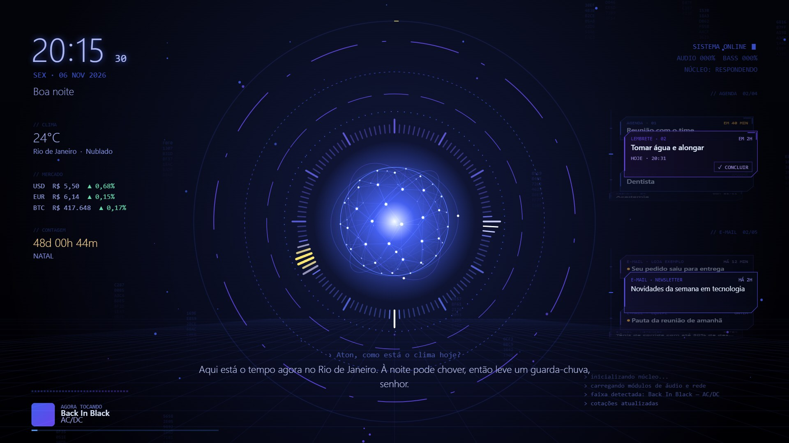
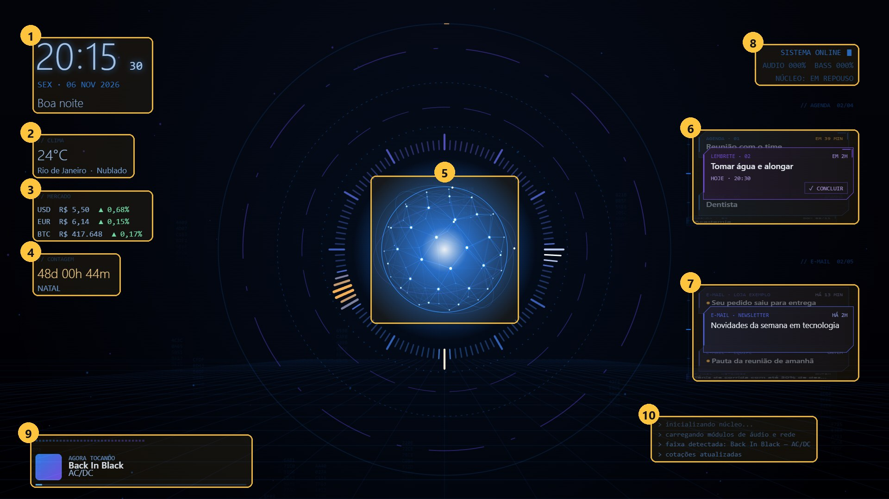
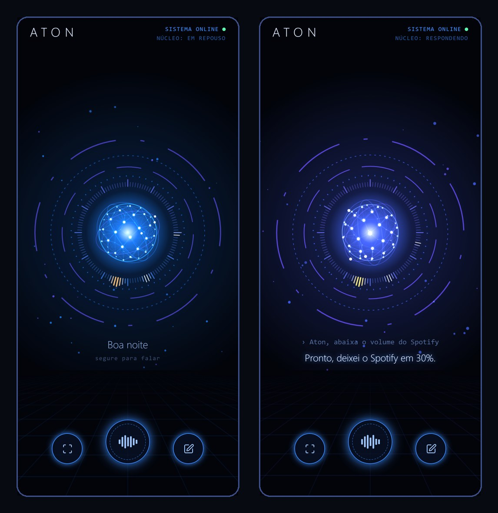

# Aton — voice assistant for Windows

🇧🇷 [Leia em português](README.pt-BR.md)

> **Language note:** Aton listens and speaks **Brazilian Portuguese**. Its commands, wake word and voice are in
> Portuguese, so the examples below show what you would say in Portuguese, with the English meaning.

Aton is a voice assistant that runs on your own PC: you say **"Aton"** followed by a request. It controls the computer,
Chrome, music, the WhatsApp desktop app, Bluetooth and windows, reads e-mail, keeps reminders, and has a phone app that
works from anywhere through a private VPN.

### Desktop dashboard

Aton shows what it is doing on an animated wallpaper (built for Wallpaper Engine; the visual interface is optional and
not part of this repository):

| # | Part | What it shows |
|---|---|---|
| 1 | Clock and greeting | Time, date and "good morning / afternoon / evening" |
| 2 | Weather | Temperature and conditions for your city |
| 3 | Market | Dollar, euro and bitcoin (in Brazilian reais), with the day's change |
| 4 | Countdown | Countdown to a date |
| 5 | Aton's core | Reacts to the PC's audio and changes while Aton is listening, thinking or speaking |
| 6 | Agenda and reminders | Cards that rotate on their own; can be marked as done |
| 7 | E-mail | Latest inbox messages |
| 8 | Status | System, audio level and core state |
| 9 | Music | What is playing, with cover art and audio bars |
| 10 | Console | System messages |

### Phone app

Talk to Aton by voice or text from anywhere through a private VPN (Tailscale), see the PC screen and open remote
control:

*All images use sample data.*

## What it does

- **Local voice**: listens for "Aton" on the PC itself (Whisper, preferably on the GPU), answers with a synthetic
  voice, keeps the conversation going without being called again, and learns words it misheard
  ("não, eu falei ..." — "no, I said ...").
- **Built-in commands (instant, no AI)**: volume, music, opening apps and websites, Chrome tabs and videos, keyboard
  shortcuts, clicking any button by its name in any program, windows, Bluetooth, time and weather.
- **Your own commands** (like Alexa Routines): written in the `meus_comandos.txt` file.
- **AI when it is not a built-in command**: a local model (Ollama) and, optionally, a cloud model. The
  **"só comandos"** ("commands only") mode turns the AI off and keeps everything predictable.
- **Chrome** (custom extension): pause and skip in videos (Netflix, YouTube, HBO Max...), fullscreen, open/close tabs,
  click links and buttons by name, search inside the current site, read the page.
- **WhatsApp desktop**: read and send messages — **it always asks for confirmation before sending**.
- **E-mail (Outlook), calendar, reminders, Spotify, clipboard, background tasks.**
- **Phone app** (`pwa/` folder): text and voice chat, PC screenshot and remote control, over the VPN.

The full command list is generated by `gerar_lista.py` (`LISTA_DE_COMANDOS.html`) or by saying
"Aton, quais comandos você conhece?" ("Aton, which commands do you know?").

## Installation and setup

Complete step-by-step guide, including how to connect **your e-mail**, **your VPN (the PC's address)**, **the local
AI**, Spotify and the phone: **[docs/SETUP.md](docs/SETUP.md)**.

Summary:
1. Windows 10/11, **Python 3.13** (not 3.14) and the Visual C++ Redistributable; an NVIDIA GPU is recommended.
2. `1_instalar.bat` → creates the environment, installs everything (about 2.5 GB, 5–15 minutes) and creates your
   `config.json` from `config.exemplo.json`.
3. `teste_sem_microfone.bat` → quick test without a microphone.
4. Install Ollama and download a local model (`ollama pull qwen3.5:4b`).
5. Fill in your `config.json` (city, microphone and, if you use them, your e-mail and Spotify app IDs).
6. `2_iniciar.bat` to start, `3_parar.bat` to stop.

## Privacy

Nothing personal is stored in this repository. Everyone creates their own accounts, keys and settings, which stay only
on their PC and are listed in `.gitignore`: `config.json`, login tokens, memory, calendar, reminders, logs, voice
recordings, the voice-trained detector, the learned vocabulary, `venv` and the models.

With the example settings the AI runs only on your PC (`"rota": "local"`) and speech recognition is always local.
The spoken voice uses Microsoft's online text-to-speech (edge-tts); e-mail and WhatsApp content is spoken with the
offline Windows voice instead, so it never leaves the PC.

The phone app's server only accepts connections from the PC itself; outside access happens exclusively through the
private Tailscale VPN, and every conversation requires a token generated on your PC.

## License

[MIT](LICENSE) — free to use, modify and share, keeping the copyright notice.
